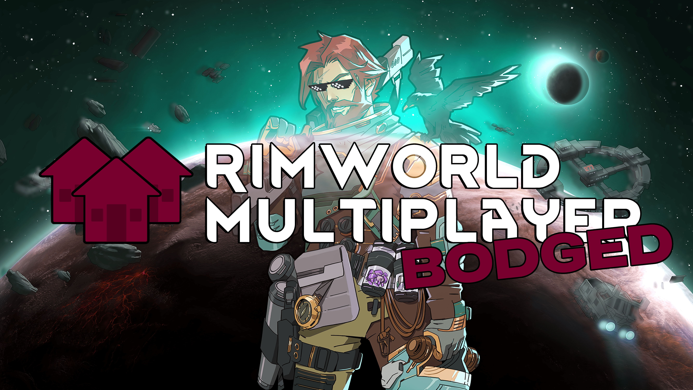

Multiplayer Bodged is a personal fork of [Multiplayer](https://github.com/rwmt/Multiplayer/) that's built upon the dev branch, includes feisty new PRs, and my own fixes. It's only hosted on GitHub for the sake of my sanity and is solely intended to be used by me and my friends currently.

## 1.7 Branch

This is a branch of the fork that specifically includes 1.7 additions, both from rwmt/Multiplayer PRs and from decompiled 1.7 rwmt/multiplayer forks on steam (which are all under MIT license). Changes are listed in [About/changelog.md](About/changelog.md).

## Donations

If you’re feeling generous these are people who have contributed greatly to the original mod’s development and upkeep. I don't know why you're considering donating here, though... this is a fork. Why are you reading this, actually?

**[Zetrith](https://patreon.com/zetrith)** - Creator, Core, Support\
**[NotFood](https://ko-fi.com/notfood)** - Core, Mod Compatiblity, Compatibility Commissions\
**[Sokyran](https://ko-fi.com/sokyran)** - Core, Mod Compatiblity, Compatibility Commissions\
[Nebual](https://ko-fi.com/Nebual) - Core\
[Thomas107500](https://ko-fi.com/thomas107500) - Mod Compatiblity\
[Luz](https://ko-fi.com/llavorre) - Support, Admin\
[Mistress Mia](https://ko-fi.com/miaamakiir) - Support, Admin\
[Swept](https://ko-fi.com/swept) - Support, Admin, Website

## Notes
Thanks to Pardeike for making [Harmony](https://github.com/pardeike/Harmony) and RevenantX for creating [LiteNetLib](https://github.com/RevenantX/LiteNetLib). Thanks to me for being awesome and deciding to slowly learn C# (I hate it).

## AI Disclosure

I have been using deepseek to simplify checking traces, and to assist me in pulling up relevant files which fire errors. Some of the code is written by me, some is written by Deepseek and carefully verified by me. As time goes on and I learn more I intend to turn "some of" into "all of." If we let machines do the thinking for us we will die a miserable death indeed, hence all solutions are thought up by me and guided by BigData(tm) until I can take the training wheels off.
